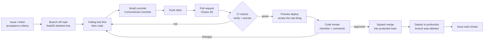

# PSYCH — Workflow

How a change moves from idea to production, and why each step exists. This is **GitHub Flow** (short-lived branches off a protected `main`), the model most product companies use: GitHub, Shopify, Stripe and Cloudflare all run variants of it. It suits PSYCH because there's one deployable thing (the site + Worker) and every merge to `main` ships.

## The flow



## Each step and why

| Step | What we do | Why companies do it |
|---|---|---|
| **1. Ticket** | Every change starts as a GitHub issue with acceptance criteria and "Blocked by" links | Work is agreed before it's built. Reviewers check the PR against written criteria, not memory. Issues give a searchable history of *why* |
| **2. Branch** | `<type>/<issue#>-<slug>` off the latest `main`, e.g. `feat/05-skeleton-live`, `fix/31-csp-hash` | `main` always works. Each idea is isolated, so a half-done change never blocks others or reaches users |
| **3. Test first** | Write the failing test, watch it fail, make it pass (TDD) | Proves the test can catch the bug. Leaves a safety net so later changes can't silently break this one |
| **4. Commits** | Small, focused, [Conventional Commits](https://www.conventionalcommits.org): `feat(order): rate limit`, `fix(csp): hash inline script`, `docs:`, `test:`, `chore:` | Readable history; each commit is easy to review or revert. Prefixes let tools build changelogs and version numbers |
| **5. Push often** | Push the branch after each meaningful commit | Backup off your laptop; CI starts early so problems surface in minutes, not at the end |
| **6. Pull request** | Open a PR using the template; body says `Closes #N` | One place for the diff, discussion, checks and the decision. `Closes #N` links code to the ticket and closes it on merge |
| **7. CI gate** | `verify` (lint, typecheck, unit, build, e2e + axe) and `secrets` (gitleaks) must pass | Machines catch the boring mistakes every time. Nobody can merge red code, including the owner |
| **8. Preview** | Each PR gets its own Cloudflare preview URL | Review the running site, not just code. Catches visual and real-device problems before users see them |
| **9. Review** | Read the diff against the ticket; a Claude `/code-review` pass plus owner read-through; resolve every comment | A second pair of eyes finds what the author can't see. Solo devs use review tools to get that second view |
| **10. Squash merge** | One commit per PR on `main`, titled like the PR | `main` history reads as a list of finished features; any feature can be reverted in one step |
| **11. Deploy** | Push to `main` triggers verify → `wrangler deploy` (production), then `wrangler deploy --env staging` (staging: own Worker and D1, AI on, for the simulator and the private beta); branch deleted | Production always equals `main`. No manual deploys, so no "works on my machine" releases |
| **12. Release** | Tag milestones (`v0.1.0` at M1, …); evals run on tags | Named points you can roll back to; heavy checks run when they matter |

## Guard rails on `main` (branch protection)

| Rule | Why |
|---|---|
| PR required; no direct pushes | Every change passes the same gate |
| Required checks: `secrets`, `verify` | Red code can't merge |
| Branch must be up to date with `main` | Checks ran against what will actually ship |
| All review conversations resolved | Nothing raised in review is forgotten |
| Linear history, squash merge only | Clean, revertible history |
| No force pushes, no deletion | History can't be rewritten or lost |
| Apply rules to admins too | The owner follows the same rules as everyone |

Approval count is 0 because GitHub won't let you approve your own PR; the review step is still done and recorded in the PR.

## Security built into the flow

| Control | Catches |
|---|---|
| GitHub secret scanning + push protection | A token blocked at `git push`, before it's public |
| gitleaks in CI | Secrets anywhere in the PR's history |
| Dependabot alerts + weekly update PRs | Known-vulnerable dependencies and Actions |
| CodeQL code scanning (free on public repos) | Injection and unsafe patterns in TypeScript |
| CI token `permissions: contents: read` | A compromised step can't write to the repo |
| Cloudflare token scoped to Workers + D1, stored as a GitHub secret | Leaked deploy credentials can't touch anything else |
| `.gitignore` for `.env*`, `.dev.vars`, `captures/` | Secrets and likeness originals never staged |

## Daily commands

```bash
git switch main && git pull
git switch -c feat/06-content-schema
# ...test, code, commit...
git push -u origin feat/06-content-schema
gh pr create --fill
gh pr checks --watch
gh pr merge --squash --delete-branch
```

## Order of work

Tickets are GitHub issues labelled `ready-for-agent`. Work the **frontier**: any ticket whose blockers are all closed. Spikes (01–04) run alongside the foundation (05–10); The Order backend (11–16) follows ticket 09.

The one exception to "PR for everything" was the bootstrap commit that created this repo: branch protection needs a `main` branch to protect.
